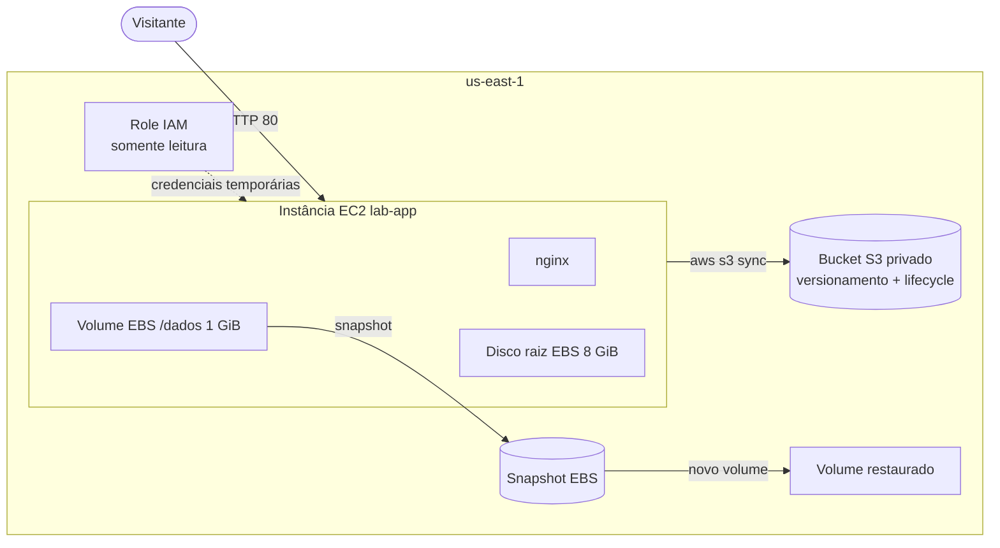

# Lab AWS: EC2 + S3 + EBS

Laboratório prático de AWS em que uma instância EC2 baixa um site de um bucket S3 **privado** usando uma **role do IAM**, guarda dados num **volume EBS** separado e recupera esses dados de um **snapshot** depois de um "desastre" simulado.

Feito como parte dos meus estudos para a certificação **AWS Certified Cloud Practitioner**.

## Arquitetura



## Serviços e conceitos praticados

| Serviço | O que foi feito | Conceito |
|---|---|---|
| Amazon S3 | Bucket privado, versionamento, regra de ciclo de vida | Armazenamento de objetos, Block Public Access, classes de armazenamento |
| AWS IAM | Política somente leitura + role para EC2 | Menor privilégio, trust policy, credenciais temporárias |
| Amazon EC2 | Instância configurada por user data | Automação na inicialização |
| AWS Systems Manager | Acesso pelo Session Manager | Administração sem SSH e sem porta 22 aberta |
| Amazon EBS | Volume extra formatado e montado em /dados | Armazenamento em bloco |
| EBS Snapshots | Backup, exclusão dos dados e restauração|

## Estrutura do repositório

```
├── site/index.html            # Página publicada pelo nginx
├── iam/s3-read-policy.json    # Política: listar e ler apenas este bucket
├── iam/trust-policy-ec2.json  # Quem pode assumir a role: o serviço EC2
├── scripts/user-data.sh       # Instala o nginx e baixa o site do S3
├── scripts/montar-volume.sh   # Formata e monta o volume EBS
├── scripts/restaurar-snapshot.sh # Monta o volume restaurado e recupera os dados
└── screenshots/               # Evidências de cada etapa
```

## Passo a passo

1. **S3:** bucket privado com versionamento e uma regra de ciclo de vida (Standard-IA após 30 dias, versões antigas apagadas após 30 dias). Acesso anônimo ao objeto retorna `AccessDenied`.
2. **IAM:** política que permite apenas `s3:ListBucket` e `s3:GetObject` no bucket, anexada a uma role com a política `AmazonSSMManagedInstanceCore`.
3. **EC2:** instância t3.micro com a role. O user data instala o nginx e sincroniza o site do bucket. Grupo de segurança só com HTTP (porta 80).
4. **EBS:** volume gp3 de 1 GiB anexado, formatado em XFS, montado em `/dados` e com dados gravados.
5. **Snapshot:** backup do volume, exclusão do arquivo e restauração a partir de um novo volume criado do snapshot.
6. **Versionamento:** nova versão do `index.html` enviada ao S3, com a versão anterior preservada.
7. **Limpeza:** todos os recursos removidos.

## Resultados

**Site servido pela EC2 a partir do bucket privado**


**A role pode ler, mas não pode apagar (menor privilégio)**


**Volume EBS montado com os dados**


**Dados recuperados a partir do snapshot**


## Problemas que encontrei e o que aprendi

| Problema | Causa | Solução |
|---|---|---|
| Não havia VPC para lançar a instância | A VPC padrão foi apagada num lab anterior | Recriada em VPC → Actions → Create default VPC|
| Site não abria (timeout) | O grupo de segurança foi criado só com SSH | Regra HTTP 80 adicionada. Timeout = bloqueio de rede |
| Página em branco | Faltava uma aspa no `<meta charset>` | HTML corrigido e reenviado ao S3 |
| Arquivo corrigido não aparecia | `aws s3 sync` não copiou (mesmo tamanho) e cache do navegador | `aws s3 cp` e janela anônima |
| Volume restaurado não montava | Mesmo UUID do volume original (XFS) | `mount -o nouuid` |
| Volumes extras sobraram após encerrar a instância | Só o disco raiz tem *Delete on termination* ligado | Volumes apagados manualmente na limpeza |

## Custos

Tudo foi feito no plano gratuito da AWS, e todos os recursos foram apagados ao final.

